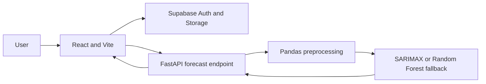

# AI Autonomous Retail Engine (AIRE)

A full-stack retail intelligence platform for exploring sales data, forecasting demand, and supporting inventory and customer decisions. Built with React, FastAPI, Python and Supabase.

## Features

- Retail dashboards for sales, products, customers and inventory.
- CSV, JSON and spreadsheet ingestion and data cleaning (duplicates, missing values and dates).
- Seven-day and 30-day forecasting with ARIMA/SARIMAX, Random Forest fallback and a simple fallback for limited data.
- Forecast evaluation using RMSE, MAE and MAPE.
- Inventory risk analysis and replenishment recommendations.
- Supabase authentication, upload history and private storage.

The system provides decision support; it does not independently execute purchases or guarantee forecast accuracy.

## Architecture



## Technology stack

| Layer | Tools |
| --- | --- |
| Frontend | React, JavaScript, Vite, CSS |
| Backend | Python, FastAPI, Uvicorn |
| Analytics | Pandas, NumPy, statsmodels, scikit-learn |
| Authentication and storage | Supabase, PostgreSQL |

## Getting started

Prerequisites: Node.js 20.19+ or 22.12+ (use a supported LTS release), Python 3.11 or 3.12 recommended, and a Supabase project. Run commands from the repository root.

```bash
npm ci
python -m venv .venv
```

Activate the virtual environment:

```powershell
# Windows PowerShell
.\.venv\Scripts\Activate.ps1
```

```bash
# macOS / Linux
source .venv/bin/activate
```

```bash
python -m pip install -r backend/requirements.txt
```

Copy `.env.example` to `.env` (`Copy-Item .env.example .env` on PowerShell, or `cp .env.example .env` on macOS/Linux). Set `VITE_SUPABASE_URL` and `VITE_SUPABASE_ANON_KEY` using the project's public client credentials. Never use a service-role or secret key in a Vite variable.

In Supabase, review and run `supabase-upload-history.sql` in the SQL editor to create the upload-history table, private storage bucket and user-scoped access policies. Enable email authentication and configure the local site URL and redirect settings as required.

```bash
npm run dev
```

Open the URL printed by Vite (normally http://localhost:5173). The API runs at http://127.0.0.1:8000. Alternatively start the API with `python -m uvicorn backend.main:app --host 127.0.0.1 --port 8000` and run `npm run dev:frontend` in another terminal.

## Demo data

Upload `data/sample_retail_sales.csv` after signing in. It contains synthetic daily sales records, not real customer information. Actual forecast quality depends on the input data; use at least 90 days of dated history where possible. Do not interpret synthetic-data scores as real-world performance.

## API

| Method | Path | Purpose |
| --- | --- | --- |
| GET | `/health` | Health check |
| POST | `/api/forecast/analyze` | Analyze a dataset with `fileName`, `columns`, and `rows` |

Interactive API documentation: http://127.0.0.1:8000/docs.

## Repository layout

```text
backend/                    FastAPI and forecasting logic
src/                        React application and analytics components
public/                     Static assets
scripts/                    Development launcher
data/                       Synthetic demo data
tests/                      Backend smoke tests
screenshots/                Instructions for capturing real screenshots
supabase-upload-history.sql Database and storage policies
.env.example                Configuration template
```

## Verification

```bash
python -m unittest discover -s tests
npm run build
npm run lint
```

## Security and limitations

- The local forecast endpoint is not authenticated by Supabase. Do not expose it publicly without server-side token verification, request limits and deployment security controls.
- Review Supabase row-level security and storage policies before deployment; live policies are not verified by this repository.
- The frontend development proxy is not a production hosting configuration.
- Evaluate forecasts on representative held-out data before using recommendations operationally.
- Screenshots should be captured from the running application; no fabricated dashboard images are included.

## Author

[Havidrak](https://github.com/Havidrak)
